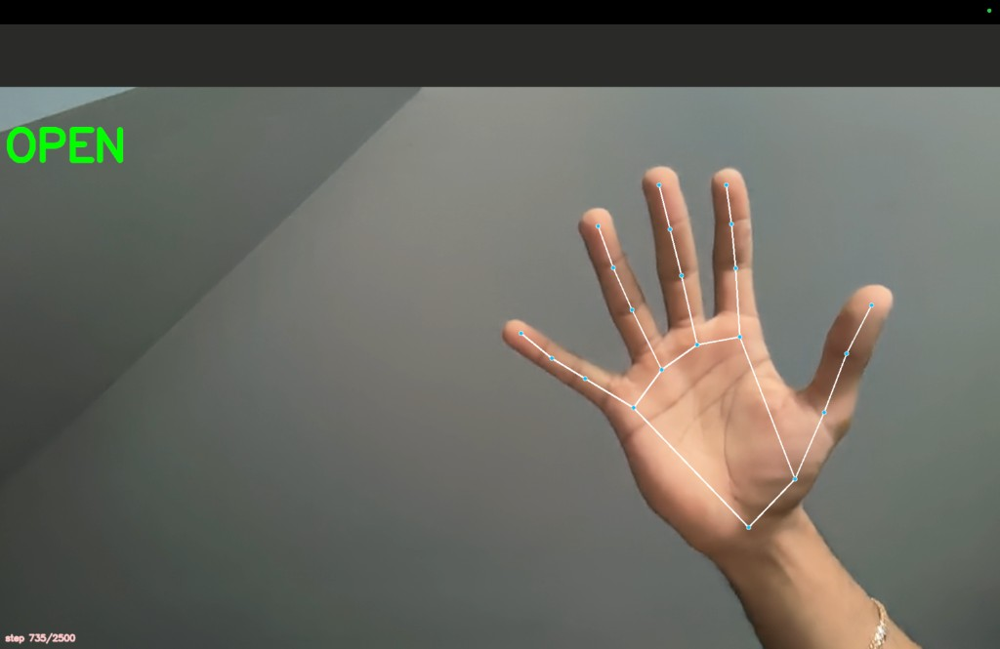
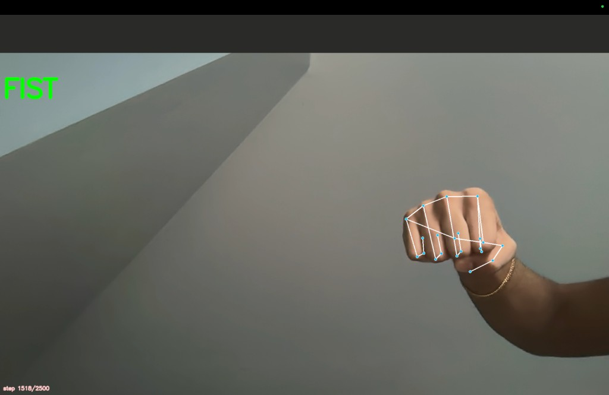
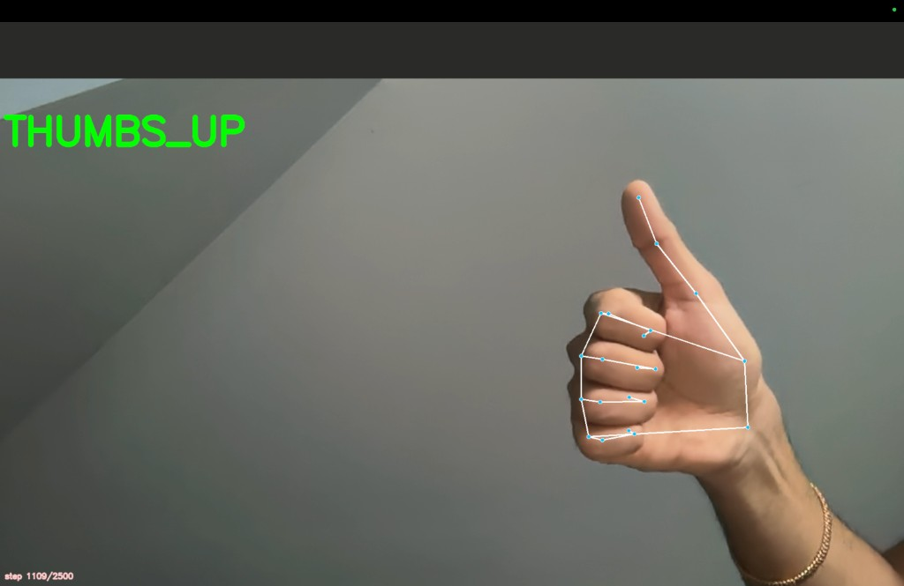
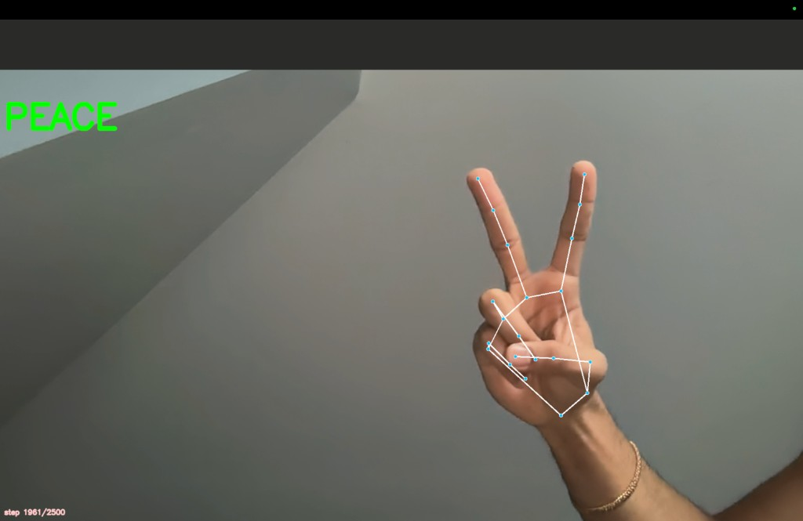

# Webcam Hand Gesture Classifier

[](https://www.python.org/)
[](https://opencv.org/)
[](https://developers.google.com/mediapipe)
[](https://numpy.org/)

Hold up your hand to a webcam and the app names the gesture in real time — open, fist, point, peace, or thumbs up — while a small Q-learning agent practices getting those labels right.

## Table of Contents

- [Features](#features)
- [Tech & Keywords](#tech--keywords)
- [Contributors](#contributors)
- [Overview](#overview)
- [Visuals & Demos](#visuals--demos)
- [Installation & Usage](#installation--usage)
- [Outcome](#outcome)
- [Reflections](#reflections)
- [Next Steps](#next-steps)
- [License](#license)
- [Citations](#citations)

## Features

- Live webcam capture with OpenCV
- MediaPipe hand landmarker (21 landmarks on one hand)
- Finger “extended vs folded” rules for open, fist, point, peace, and thumbs up
- Q-learning agent that maps finger-state codes to gesture labels
- On-screen label + landmark overlay while training
- Saves a Q-table to `q_gesture.npz` so a run can continue from a saved policy

## Tech & Keywords

`Python` · `OpenCV` · `MediaPipe` · `Hand Landmarker` · `NumPy` · `Q-learning` · `Computer Vision` · `Reinforcement Learning` · `Webcam`

## Contributors

| Name | Role |
| ---- | ---- |
| Keshav Patel | Solo project — vision pipeline, gesture rules, Q-learning loop, and demo packaging |

## Overview

This project is a small desktop demo that **watches your hand on camera** and **says which gesture you’re making**.

In simple terms:

1. You run the program and allow camera access.
2. You show one hand to the webcam (open palm, fist, point, peace, or thumbs up).
3. The app finds your hand joints and decides which fingers are up.
4. A learning agent practices naming that finger pattern as a gesture.
5. The screen shows the label in large green text while it trains for a few thousand steps.

Under the hood it uses **MediaPipe** for landmarks, simple geometry for finger flags (32 possible states), and a **Q-table** that learns which gesture fits each state. The finger rules are the “teacher”; Q-learning is what the program practices live.

## Visuals & Demos

### Open hand



*Caption: Palm open to the camera. Landmarks and connections are drawn on the hand; the overlay reads **OPEN** during training (`step 735/2500`).*

### Fist



*Caption: Closed fist. The classifier labels the pose **FIST** while the step counter continues (`step 1518/2500`).*

### Thumbs up



*Caption: Thumb extended, other fingers folded. Overlay shows **THUMBS_UP** (`step 1109/2500`).*

### Peace sign



*Caption: Index and middle fingers extended (V shape). Overlay shows **PEACE** (`step 1961/2500`).*

### How the pipeline fits together

```
Webcam (OpenCV)
  → MediaPipe Hand Landmarker (21 points)
       → Finger flags (5 bits → 32 states)
            → Reference gesture from rules
            → Q-learning agent (state → gesture action)
                 → On-screen label + save q_gesture.npz
```

| Path | Responsibility |
| ---- | -------------- |
| `RL.py` | Camera loop, landmarks, Q-learning, overlay UI |
| `models/hand_landmarker.task` | MediaPipe hand model asset |
| `q_gesture.npz` | Saved Q-table from a training run |
| `docs/screenshots/` | Demo stills for this README |
| `requirements.txt` | Python dependencies |

## Installation & Usage

### Prerequisites

- Python 3.x
- A working webcam
- macOS / Windows / Linux with camera permissions for the terminal or IDE

### How to install and run

```bash
git clone https://github.com/Kpatel1013/hand-gesture-classifier.git
cd hand-gesture-classifier

python3 -m venv .venv
source .venv/bin/activate   # Windows: .venv\Scripts\activate
pip install -r requirements.txt
python RL.py
```

Make sure `models/hand_landmarker.task` is present. A camera window opens; press **`q`** to quit early, or wait until the step limit finishes.

Optional arguments:

```bash
python RL.py --camera 0 --train-steps 2500 --epsilon 0.2 --save q_gesture.npz
```

| Flag | Purpose |
| ---- | ------- |
| `--camera` | OpenCV camera index (default `0`) |
| `--train-steps` | How many RL update steps to run (default `2500`) |
| `--epsilon` | Exploration rate while training (default `0.2`) |
| `--save` | Where to write the Q-table (default `q_gesture.npz`) |

### How to use

1. Start the script and grant camera access if prompted.
2. Hold one hand in frame; keep the background reasonably clear.
3. Try **open**, **fist**, **point**, **peace**, and **thumbs up**.
4. Watch the green label and the step counter in the corner.
5. Press **`q`** when you’re done — the Q-table saves to the path you set.

## Outcome

- A runnable webcam demo that classifies common one-hand gestures
- Clear visual feedback (landmark skeleton + large gesture label)
- A concrete intro to combining computer vision with tabular Q-learning
- A saved `q_gesture.npz` so training progress isn’t thrown away after each run

## Reflections

**Rules as the teacher.** Finger geometry gives a cheap, understandable label. That made Q-learning easier to demo: the agent isn’t guessing from pixels alone; it’s learning to map discrete finger states to those rule-based names.

**Why Q-learning here?** A 32×6 table is small enough to train in a few thousand webcam frames. It’s a teaching-friendly RL setup, not a deep model — on purpose, so the loop stays inspectable.

**Camera and confidence tradeoffs.** MediaPipe needs a visible hand and decent lighting. Confidence thresholds and a one-hand limit keep the UI stable, but awkward angles or two hands in frame will still confuse it.

**What “NONE” is for.** Ambiguous poses (three fingers up, weird angles) map to `NONE` so the agent isn’t forced to pick a wrong named gesture every frame.

## Next Steps

Ideas for the future:

- Load `q_gesture.npz` in a pure “inference” mode (no exploration)
- Add more gestures (e.g. rock / OK) with clearer rules
- Smooth labels over a short window so flicker drops
- Record a short demo GIF or video for this README
- Optional sound or hotkey when a gesture locks in

**Call to action:** Feedback and ideas are welcome. Open a [GitHub issue](https://github.com/Kpatel1013/hand-gesture-classifier/issues) on this repo, or connect on [LinkedIn](https://www.linkedin.com/in/keshavpatel13) if you’d like to discuss the design.

To conclude — thanks for reading. If you try the demo with your webcam, I’d love to hear which gestures worked best for you.

## License

Personal / portfolio project. All rights reserved unless a license file is added later.

## Citations

- [MediaPipe](https://developers.google.com/mediapipe) — hand landmarker
- [OpenCV](https://opencv.org/) — webcam capture and drawing
- [NumPy](https://numpy.org/) — Q-table storage and updates
- Classic Q-learning (Watkins) — tabular reinforcement learning method used in `RL.py`
